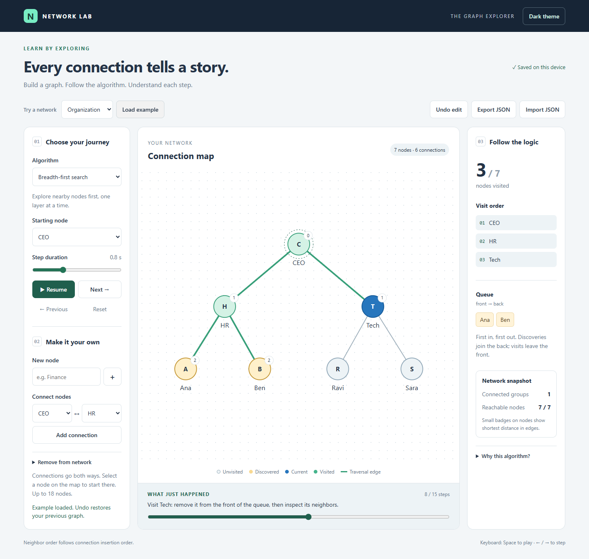

# Network Lab — DSA Graph Visualizer

An interactive, dependency-free laboratory for understanding breadth-first search and depth-first search on undirected, unweighted graphs.



## Run

Open this folder in VS Code. In the PowerShell terminal:

```powershell
start .\index.html
```

Or open `index.html` directly in your browser. No installation or build step is required.

## Explore

- Watch individual discoveries, visits, and DFS returns.
- Inspect the BFS queue or DFS call stack at each step.
- See BFS shortest distances and the traversal discovery tree.
- Play, pause, replay, step backward, or scrub the timeline.
- Add or remove nodes and connections; undo the last 30 edits.
- Try organization, cycle, and disconnected examples.
- Save automatically in browser storage; export and import validated JSON graphs.
- Switch between light and dark themes.
- Use a responsive layout, keyboard controls, and accessible node buttons.

Space toggles playback and arrow keys step when focus is outside an interactive control. Focus a graph node and press Enter or Space to start from it.

The graph supports 1–18 nodes and names up to 24 characters. Names are unique without regard to case. Duplicate edges and self-connections are rejected. Removing a node also removes its incident connections. Loading or importing a graph can be undone.

## Algorithms

BFS uses an adjacency list, a queue with a moving head index, and a visited set. It discovers each node once and computes shortest distance by edge count. DFS uses recursion and a visited set; separate return frames show backtracking. Neighbor order follows edge insertion order. A traversal explores only the starting node's connected component.

For the organization example starting at CEO:

- BFS: CEO → HR → Tech → Ana → Ben → Ravi → Sara
- DFS: CEO → HR → Ana → Ben → Tech → Ravi → Sara

Core traversal takes O(V + E) time and O(V) auxiliary space. Playback records O(V) snapshots of up to O(V) data, so snapshot storage can take O(V²) space. Rendering and network statistics have additional costs; these do not change the core graph algorithm complexity. DFS depth badges are not displayed because DFS does not guarantee shortest paths.

## Files

| File | Purpose |
| --- | --- |
| `index.html` | Interface and accessible controls |
| `style.css` | Responsive layout, graph states, and themes |
| `algorithms.js` | Pure traversal and connected-component functions |
| `app.js` | Editing, playback, validation, and browser storage |
| `algorithms.test.cjs` | Algorithm regression checks |

## Verify

With Node.js installed:

```powershell
node algorithms.test.cjs
```

Checks cover BFS/DFS order, DFS returns, shortest distances, cycles, disconnected graphs, and a single node.

Manual checks:

1. Add Finance; the connected-group count becomes 2. Connect it to CEO; the count becomes 1.
2. Delete Finance, then Undo. Refresh and verify the restored graph persists.
3. Select DFS, play to completion, then step backward through return frames.
4. Export a graph and import it again. An invalid graph should show an error without changing the network.
5. Try the dark theme and a narrow browser window.

## Publish a live demo

Upload these files to the root of your GitHub repository, including `algorithms.js`. In the repository, open **Settings → Pages**, choose **Deploy from a branch**, select **main** and **/(root)**, then Save. GitHub will display the demo URL after publishing. Use that URL in your repository's About section.

## Storage and limitations

Graphs and theme preferences are stored on the current browser/device. Storage for local files can vary between browsers; export JSON for a portable backup. No account or server is required. Undo history is kept only for the current page session. The visualizer models undirected, unweighted graphs and uses a compact automatic layout; dense networks may contain crossing edges. It does not yet include weighted algorithms or draggable positions.

